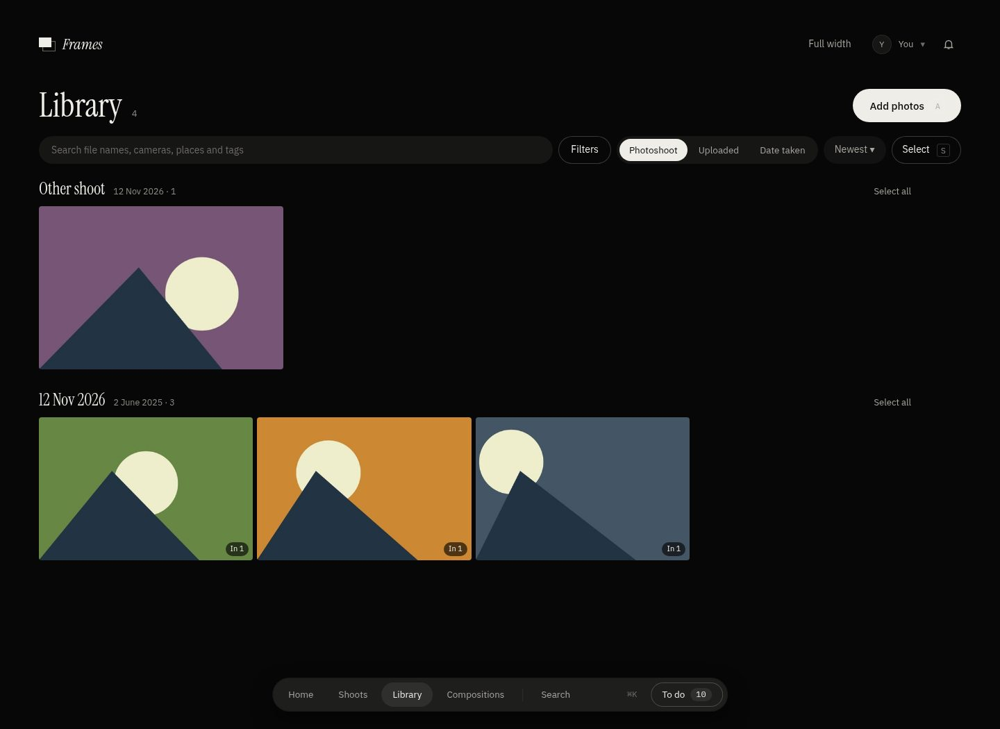
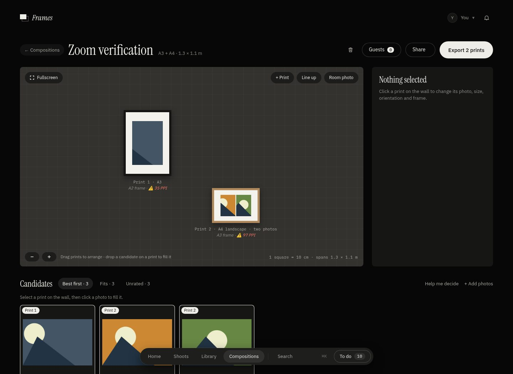

This is AI slop

# Frames

A self-hosted archive for portfolio photographs: organise them into photoshoots, review them over several sessions so your real opinion settles, find what's strongest, and curate compositions you can download as untouched original files or share with a link.

**Full documentation is in the [wiki](https://github.com/trentnbauer/Frames/wiki).**

## What it does

- **Photoshoots and a library.** Photographs are read from a folder you mount (read-only), uploaded, or synced from Google Drive, Dropbox or OneDrive. Originals are never modified or deleted.
- **Reviews.** Rate each photograph over several sessions, spaced out, so a settled opinion emerges. Optionally let other members rate yours anonymously.
  Starting a review inside a photoshoot reviews only its photographs that have not yet been rated. If none remain, it shows “Nothing to review” rather than starting a library review. Reviewing selected photographs from the Library also keeps that selection.
- **Compositions.** Plan a wall of prints to scale, against a photo of your room if you like, then export the untouched originals or a print sheet.
- **Sharing.** Send a link for guests to rate photographs or suggest other prints, frames or layouts. A public portfolio, optional.
- **Finding things.** Search understands cameras, lenses, film stocks, places and file names. Optional AI adds tags, descriptions and search by meaning.
- **Several people on one server**, each with their own library. Sign in with an emailed code, a passkey, Google, Microsoft, GitHub, any OpenID Connect server, or Cloudflare Access. Light and dark themes, and phone and tablet layouts.
- **Run by you.** Backups (including to S3 or your cloud account), a Cloudflare tunnel to reach it from outside, and the terms and privacy page are all set in the app by an administrator. If nobody can sign in, an emergency login is written to the server log at each start.

## Screenshots

The Library and composition editor, shown with a small demo library of sample images.





## Run with Docker

Start with no settings, set everything up in the app, then export it.

1. Save [`docker-compose.minimal.yml`](docker-compose.minimal.yml) in a folder, put your photographs in a `photos` folder beside it, and run:

   ```sh
   docker compose -f docker-compose.minimal.yml up -d
   ```

   It needs Docker Compose 2.24 or newer. Frames listens on `127.0.0.1:3000` only until you decide otherwise.
2. Open http://localhost:3000, go to **Photoshoots** and press **Sync library** (or **Upload photos**).
3. Fill in the settings in the app (**Settings**): sign-in, AI, cloud accounts, your portfolio, the tunnel.
4. Optionally open **Settings, Server, Updates & system**, turn on the export and download `frames.env`. Put it next to the compose file and start again: from then on it is the source of truth. Keep it private; it holds every secret.

The container runs as an unprivileged user with a read-only filesystem. Your photographs are mounted read-only, and the database and previews live in the `frames-data` volume (back it up; the app can also make and restore backups).

## Documentation

[Installation](https://github.com/trentnbauer/Frames/wiki/Installation) · [Environment variables](https://github.com/trentnbauer/Frames/wiki/Environment-variables) · [The env file](https://github.com/trentnbauer/Frames/wiki/Env-file) · [Server settings](https://github.com/trentnbauer/Frames/wiki/Server-settings) · [Signing in](https://github.com/trentnbauer/Frames/wiki/Sign-in) · [Compositions](https://github.com/trentnbauer/Frames/wiki/Compositions) · [Share links](https://github.com/trentnbauer/Frames/wiki/Share-links) · [Backup and restore](https://github.com/trentnbauer/Frames/wiki/Backup-and-restore) · [Known limits](https://github.com/trentnbauer/Frames/wiki/Known-limits) · [Development](https://github.com/trentnbauer/Frames/wiki/Development)

## Develop

```sh
cd server && npm install && npm run dev      # API on :3000
cd web && npm install && npm run dev         # UI on :5173, proxies /api to :3000
```

`npm test`, `npm run typecheck` and `npm run build` work in both folders. Node 22 or newer. See [`CLAUDE.md`](CLAUDE.md) for how changes are made (pull requests, release labels, checks).

## Photo and composition tools

The **To do** page uses the same **Add to composition** picker as the Library and photo pages, including search and new compositions. The editor's **Remove** action removes a candidate only from that composition; if a print holds it, confirmation is required and that print is left empty. Candidate previews use thumbnails, while the wall uses larger previews.

Photoshoots have a **Share** button with the existing link, expiry, PIN and guest review controls. On a photo, **Colour & variants** opens its palette and actual linked photographs. Accepted AI tags show a non-clickable tick; the separate × button removes a tag. Settings → Tags & subjects has one searchable management modal for both types, with create, rename, merge within a type, and delete. These changes use existing data and do not merge tag and subject records automatically.

Composition cards show the saved layout, orientation, frames, mats, crops and both photographs in a stacked print, fitted closely into the preview. **Room photo** in the editor uploads a room picture; **Set scale** calibrates it against a known width. The room picture follows wall zoom and pan and stays private to its owner.

Click a photoshoot’s date to apply a new date to every photograph in that shoot. This updates the displayed date without changing the camera date or original file; another shoot is unaffected. Keyword search accepts phrases such as **milky way at Cape Schanck**, combining tags and locations without searching for the connecting word. This does not add typo correction.

Photographs added to the portfolio by hand are managed under **Settings → Portfolio → Added by hand**. The automatic backing list is hidden from Compositions; a regular composition deliberately chosen for the portfolio remains visible.

### Zoom

Scroll over the composition wall, pinch a trackpad, or use two fingers on a touchscreen to zoom from 50% to 400%. The bottom-left **−** and **+** buttons zoom around the centre. Drag empty wall space to pan. These controls also work in fullscreen and guest editors. Zoom and pan affect only the current view: print sizes, positions, photo crops and exports stay the same. Scrolling a settings panel keeps scrolling that panel. The view resets when the editor is reopened.

## Security

To report a vulnerability, see [`SECURITY.md`](SECURITY.md).

## Library layout and account security

Library and Photoshoots have a **Full width** toggle in the header. The preference is saved per library and shared between these screens. **Comfortable width** restores the centred layout. The Frames logo, account menu and notifications remain visible while scrolling, above the page toolbar; both headers match the page background in light and dark themes.

Under **Settings → Your library → Password & security**, manage linked sign-in methods and passkeys, inspect active personal sessions and the latest 100 successful sign-ins, and sign out individual sessions. Signing out this browser returns it to sign-in; signing out another browser invalidates it on its next request. People see only their own sessions. New sign-ins record the IP address as seen by the server and the browser's user-agent; correct reverse-proxy configuration is needed for a client's original IP. Existing sessions remain usable and show “IP not recorded” / “Device not recorded”. Shared-password and automatic access do not create personal sessions. The log records successful sign-ins, not failed attempts; up to 1,000 past sign-ins are retained per account, alongside active sessions.

Under **Settings → Server → Sign-in & access**, each provider's **Configure** opens only that provider's settings and setup instructions. Other providers and general server access settings are kept out of this modal. Real external OAuth providers and physical passkey registration require testing with your own accounts and device.
