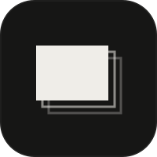
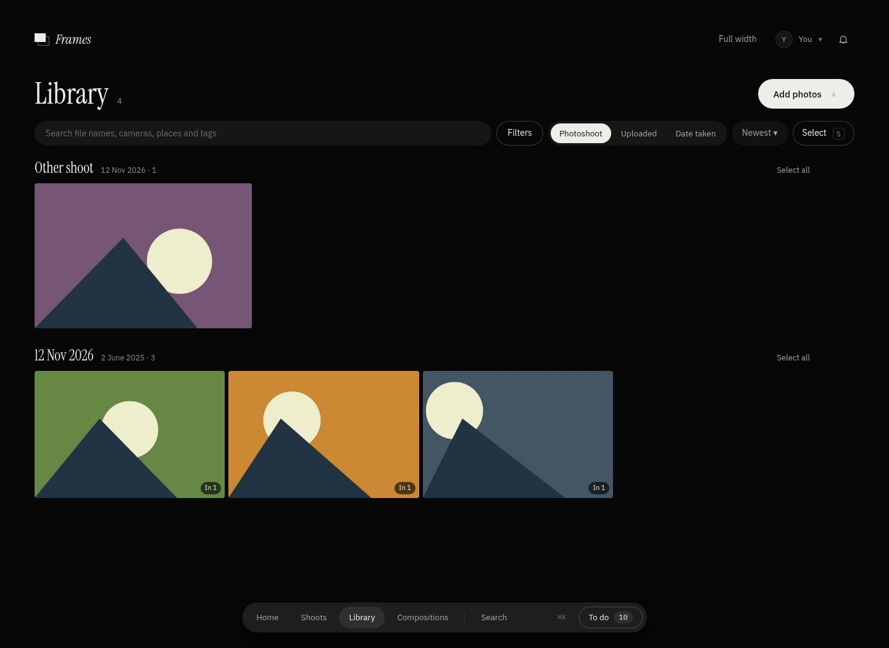
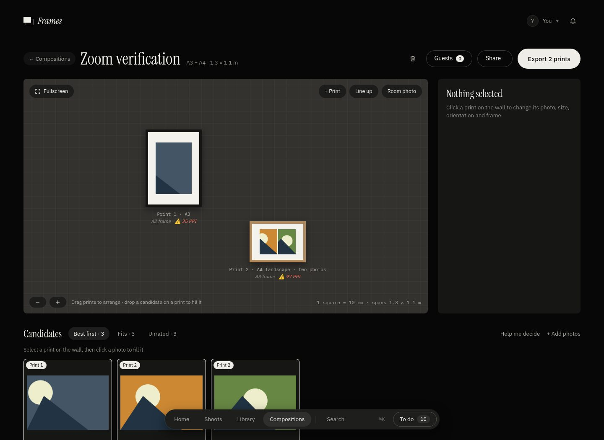

This is AI slop




# Frames

A self-hosted archive for portfolio photographs: organise them into photoshoots, review them over several sessions so your real opinion settles, find what's strongest, and curate compositions you can download as untouched original files or share with a link.

**Full documentation is in the [wiki](https://github.com/trentnbauer/Frames/wiki).**

## What it does

- **Photoshoots and a library.** Photographs are read from a folder you mount (read-only), uploaded, or synced from Google Drive, Dropbox or OneDrive. Originals are never modified or deleted.
- **Reviews.** Rate each photograph over several sessions, spaced out, so a settled opinion emerges. Optionally let other members rate yours anonymously.
  Starting a review inside a photoshoot reviews only its photographs that have not yet been rated. If none remain, it shows “Nothing to review” rather than starting a library review. Reviewing selected photographs from the Library also keeps that selection.
- **Compositions.** Plan a wall of prints to scale, against a photo of your room if you like, then export the untouched originals or a print sheet.
- **Sharing.** Send a link for guests to rate photographs or suggest other prints, frames or layouts. A public portfolio, optional.
- **Finding things.** Search understands cameras, lenses, film stocks, places and file names. Optional AI adds tags, descriptions and search by meaning.
- **Several people on one server**, each with their own library. Sign in with an emailed code, a passkey, Google, Microsoft, GitHub, any OpenID Connect server, or Cloudflare Access. Light and dark themes, and phone and tablet layouts.
- **Run by you.** Backups (including to S3 or your cloud account), a Cloudflare tunnel to reach it from outside, and the terms and privacy page are all set in the app by an administrator. If nobody can sign in, an emergency login is written to the server log at each start.

## Screenshots

The Library and composition editor, shown with a small demo library of sample images.





## Run with Docker

Start with no settings, set everything up in the app, then export it.

1. Save [`docker-compose.minimal.yml`](docker-compose.minimal.yml) in a folder, put your photographs in a `photos` folder beside it, and run:

   ```sh
   docker compose -f docker-compose.minimal.yml up -d
   ```

   It needs Docker Compose 2.24 or newer. Frames listens on `127.0.0.1:3000` only until you decide otherwise.
2. Open http://localhost:3000, go to **Photoshoots** and press **Sync library** (or **Upload photos**).
3. Fill in the settings in the app (**Settings**): sign-in, AI, cloud accounts, your portfolio, the tunnel.
4. Optionally open **Settings, Server, Updates & system**, turn on the export and download `frames.env`. Put it next to the compose file and start again: from then on it is the source of truth. Keep it private; it holds every secret.

The container runs as an unprivileged user with a read-only filesystem. Your photographs are mounted read-only, and the database and previews live in the `frames-data` volume (back it up; the app can also make and restore backups).

## Documentation

[Installation](https://github.com/trentnbauer/Frames/wiki/Installation) · [Environment variables](https://github.com/trentnbauer/Frames/wiki/Environment-variables) · [The env file](https://github.com/trentnbauer/Frames/wiki/Env-file) · [Server settings](https://github.com/trentnbauer/Frames/wiki/Server-settings) · [Signing in](https://github.com/trentnbauer/Frames/wiki/Sign-in) · [Compositions](https://github.com/trentnbauer/Frames/wiki/Compositions) · [Share links](https://github.com/trentnbauer/Frames/wiki/Share-links) · [Backup and restore](https://github.com/trentnbauer/Frames/wiki/Backup-and-restore) · [Known limits](https://github.com/trentnbauer/Frames/wiki/Known-limits) · [Development](https://github.com/trentnbauer/Frames/wiki/Development)

## Develop

```sh
cd server && npm install && npm run dev      # API on :3000
cd web && npm install && npm run dev         # UI on :5173, proxies /api to :3000
```

`npm test`, `npm run typecheck` and `npm run build` work in both folders. Node 22 or newer. See [`CLAUDE.md`](CLAUDE.md) for how changes are made (pull requests, release labels, checks).

### Container builds and releases

Pull requests validate image changes on native Linux AMD64 and ARM64 runners, with a separate BuildKit cache for each architecture. Every push to `main` runs CI once through the version workflow, including changes labelled `release: none`. A release builds each image once, checks that exact image starts and reports the correct version, then publishes the multi-architecture manifest from the tested digests. The publisher does not rebuild. Manually pushed version tags use the same validation and publishing steps. Both architectures use the same generated changelog; version, major/minor and stable `latest` tags keep their existing behavior.

Docker installs system packages before copying application files or applying the release version, so ordinary code/version changes can reuse that layer. A cold cache, changed dependencies or an updated base image still requires the corresponding installation work. If a build network uses a private trusted CA, supply it without disabling TLS verification: `docker build --secret id=extra_ca,src=/path/to/trusted-ca.pem -t frames .`. The certificate is mounted only during networked build steps and is not copied into the image.

## Photo and composition tools

Current UI screenshots and detailed guides are in the [wiki gallery](https://github.com/trentnbauer/Frames/wiki/Screenshots) and [App settings guide](https://github.com/trentnbauer/Frames/wiki/App-settings). The visual conventions are documented in [DESIGN.md](DESIGN.md), including **✦** before AI-derived data and **circle → diamond → square** for workflow stages.

Compositions have explicit **Progress**, **Review**, and **Done** stages. Filling every artwork slot does not change the stage automatically; Review and Done require every slot to hold a photo, including both halves of stacked prints. Emptying a slot while reviewing returns the composition to Progress. In Done the composition is read-only: its name, layout, crops, frames, candidates and room photo cannot be edited or deleted until it is reopened. The workflow selector stays visible in Done. Choose **Progress** or **Review** to reopen the composition; if artwork is missing, choose Progress first. **Export** appears in the **Done · Read-only** side panel where frame editing normally appears, keeping the header actions in place. The composition title and action bar scroll with the editor; the Compositions list header stays sticky below the app header. Zoom, fullscreen, sharing and original downloads remain available in Done. The composition list uses the same three stages, with export actions under Done, and candidate pickers leave out Done compositions.

Previously printed compositions migrate to Done; other compositions start in Progress. Original photographs are unchanged. Legacy printed/reopen requests map to Done/Progress. Library-level changes to a photo can still affect what a saved composition displays; Done protects the composition's own controls and write endpoints. If a Done composition is also the portfolio's backing list, reopen it before changing that list's candidates.

Portfolio owner edit links are plain text. The owner-only visibility and destinations are unchanged.

The composition Share dialog uses the current composition name, including after a rename. While editing, type directly into the composition title to rename it: Enter or leaving the field saves, Escape cancels, and a blank name restores the saved title. Save failures appear below the title.

Photoshoot and composition sharing use the same dialog. Choose permissions, expiry, name and optional PIN before **Create link**; existing links can be copied, previewed, updated, regenerated or stopped. Photoshoots offer ratings and downloads; compositions also offer suggestions and wall-only viewing.

Your own public portfolio shows **Edit Portfolio** and **Edit Gear** at the top left when your sign-in is available on that address. Other visitors do not see them. A separate portfolio hostname needs the app's public URL configured and an owner session available there; cookies do not carry across unrelated domains. Shared-password access and an unprotected local instance also show the owner's links. Portfolio configuration containing these links is never cached.

`/auth/signin` redirects to `/signin`, preserving the return address, guest mode and error message. Provider buttons use the same light filled style on sign-in and sign-up. The sign-in footer has one working **Privacy** link beside **Terms**. OAuth, email codes, passkeys and the shared password keep their existing flows; live third-party sign-in must be checked with your configured providers.

When **Camera** or **Lens** is selected under Settings → Your library → Reviews → To do list counts photos missing, a photo missing that detail appears in To do’s **Everything** queue and badge count as well as the **Camera** or **Lens** filter. Camera and lens fields are shown in Everything for those photos; saving the missing detail removes that task. Camera/lens values cleared by the gear blacklist follow the same rule. Camera and Lens are independent opt-in reasons: turning either off excludes tasks caused only by that missing detail.

The **To do** page uses the same **Add to composition** picker as the Library and photo pages, including search and new compositions. The editor's **Remove** action removes a candidate only from that composition; if a print holds it, confirmation is required and that print is left empty. Candidate previews use thumbnails, while the wall uses larger previews.

Photoshoots are automatically removed when their last photo is deleted from Frames or moved to another shoot, together with their shoot share links. Existing empty shoots are cleaned up on upgrade. Shoots containing archived or missing-file records are retained; only a genuinely empty shoot is removed. A newly created empty shoot can still be filled, and a scan that imports no photos does not leave an empty shoot behind. This cleanup removes database records only; it does not remove original files.

Photoshoots have a **Share** button with the existing link, expiry, PIN and guest review controls. On a photo, **Colour & variants** opens its palette and actual linked photographs. AI tags show a ✦ marker before their name instead of an inert tick; the separate × button removes a tag. Settings → Tags & subjects has one searchable management modal for both types, with create, rename, merge within a type, and delete. These changes use existing data and do not merge tag and subject records automatically.

Composition cards show the saved layout, orientation, frames, mats, crops and both photographs in a stacked print, fitted closely into the preview. **Room photo** in the editor uploads a room picture; **Set scale** calibrates it against a known width. The room picture follows wall zoom and pan and stays private to its owner.

Click a photoshoot’s date to apply a new date to every photograph in that shoot. This updates the displayed date without changing the camera date or original file; another shoot is unaffected. Keyword search accepts phrases such as **milky way at Cape Schanck**, combining tags and locations without searching for the connecting word. This does not add typo correction.

Photographs added to the portfolio by hand are managed under **Settings → Portfolio → Added by hand**. The automatic backing list is hidden from Compositions; a regular composition deliberately chosen for the portfolio remains visible.

### Zoom

Scroll over the composition wall, pinch a trackpad, or use two fingers on a touchscreen to zoom from 50% to 400%. The bottom-left **−** and **+** buttons zoom around the centre. Frames and the background move together immediately during pan and zoom, without animating their positions or sizes behind the pointer. Drag empty wall space to pan. These controls also work in fullscreen and guest editors. Zoom and pan affect only the current view: print sizes, positions, photo crops and exports stay the same. Scrolling a settings panel keeps scrolling that panel. The view resets when the editor is reopened.

## Security

To report a vulnerability, see [`SECURITY.md`](SECURITY.md). The [application review notes](docs/security-review-2026-11-16.md) record the latest API permission and wall-only sharing fixes, test coverage and open follow-up findings.

## Library layout and account security

The user dropdown has **Clear site data**, immediately above **Sign out**. Confirm **Clear and reload** to reset this origin's cached files and local site preferences and sign out of Frames, then reload Frames. You may need to sign in again; photos, reviews and server settings are retained. Clearing the HTTP cache uses the browser's `Clear-Site-Data` support (normally over HTTPS). Only the host-only Frames session cookie is expired; cookies and sign-ins on other subdomains are preserved. Local storage, browser-managed caches, service workers and supported IndexedDB storage are also cleared directly as a fallback.

Personal **email and password** sign-in is available when an administrator enables **Settings → Server → Sign-in & access → Allow password sign-in** (off by default). Members set or change their own password under **Your library → Password & security**. Passwords must be 12–256 characters; password managers and pasting work. The sign-in page offers **Sign in with a password** only while the method is enabled, and the server refuses direct password requests when it is disabled. Existing sessions remain signed in. The separate `AUTH_PASSWORD` shared server password and temporary emergency administrator are unchanged.

For an initial password-only setup, enable the method while signed in as the owner, open Password & security, enter the owner's email and set a password, then enable **Require sign-in**. This binds the existing owner library rather than creating another one. The email is the login name; setup does not send a verification email. A new member first joins through an invitation/verified email or an external provider, then sets a password; there is no public password-only signup form. Guests and emergency administrators cannot enrol a personal password. Keep another working sign-in method before disabling password sign-in: Frames refuses to disable the only configured way in while sign-in is required.

Password sign-in follows the existing authenticator/passkey two-factor requirements. Passwords are stored as slow salted scrypt hashes, encrypted with other server secrets, and omitted from backups and exports. Login attempts are rate limited by address and account and respect the configured human check. Changing a password requires a current password or a sign-in within the last 15 minutes, and signs out other sessions. To recover a forgotten password, sign in another way and set a new one; no separate password-reset email flow is provided. An administrator can enable an alternate method for the account. The owner can use the existing emergency recovery or `AUTH_DISABLE=true` if no other method is available.

**Server → Updates & system** shows the current version, the release check and the “Show admins what’s new” preference. The update-channel selector has been removed; deploy the desired Docker image tag through your server configuration.

The sun/moon icon immediately left of the user dropdown switches between light and dark mode and remembers the choice in this browser. It uses the same theme preference as Settings. **Settings → Your library → App settings** contains the **Dark / Light** theme choice and **Full width** toggle, along with the start page, print units and date format preferences. Start page, print units and date format are saved preferences that are not yet applied throughout the app. **Welcome tour** is under Help in App settings rather than in the user dropdown.

On opening or reloading the app, a changed deployed version automatically clears browser caches and reloads once, preserving sign-in and preferences. The first visit records the deployed version without a reset. It does not reload an open editing session; development versions and unavailable health checks skip the reset. **Clear site data** is also available under Troubleshooting, with its existing confirmation and user-menu shortcut. Open **Settings** from the user dropdown, then choose **App settings** under Your library. Settings cards, navigation, fields, toggles, selectors and popovers follow the selected light or dark theme.

Full width applies across the signed-in app, including Home, Photoshoots, Library, Compositions, the editor, Gear, Stats and Settings. It preserves the existing saved width preference; turn it off to restore the comfortable centred layout. Dialogs and individual form fields retain their own sizing.

The Home review banner uses theme-aware text, buttons and a subdued photo tint, including the “Nothing is waiting” state. The shared header uses Home’s position across navigation, with the account menu and notification bell. The header and browse toolbars remain visible while scrolling, including the Compositions list title, New composition action, workflow tabs, search and sort controls, and the editor wall and controls follow the selected theme. Public portfolios and guest share pages retain their independent layouts.

The notifications panel has **Clear** beside **Mark all read**. Clear removes both read and unread notifications from your panel, including older entries beyond the first page, and clears the unread indicator. It affects only your own library. Previously cleared events stay suppressed under the existing retention rules; new events can still arrive. Empty panels disable Clear, and a failed clear keeps the entries visible with an error.

Each item in **Found in your photos** has separate **Add to gear** and **Blocklist** actions. Blocklist moves it into **Blacklisted gear** below the owned blocks without adding it to owned gear, and clears the matching camera/lens metadata from existing photos.

Each newly discovered camera body or lens gets its own gear notification with **Add to gear** and **Blacklist**. Discoveries come from library metadata, including import and metadata changes; existing unknown gear is picked up when the bell or Gear page loads. Nothing is added to owned gear automatically. Known owned gear is excluded, and the same piece is remembered even after its notification is dismissed or removed by retention. Each notification also has a dismiss **×** in its top-right corner.

Under **What I own**, **Found in your photos** keeps its discovered-gear tags and photo counts above the owned gear blocks, with an empty message when there are no suggestions. **Blacklisted gear** lists blocked gear as tags at the bottom, underneath those blocks. Type a name and press Enter (or Add) to block it; use × to remove a tag. Blacklisting removes matching items from **Found in your photos** and suppresses future discovery alerts. Matching ignores case, spacing and punctuation; manually entered names apply to both camera and lens metadata. Blacklisted camera/lens values are cleared from all existing Frames photo records, including archived and missing photos, and their automatic gear tags are removed. Future imports, metadata re-reads, manual edits and shoot/default overrides cannot reintroduce a blocked value. Existing blacklists are applied when the library is opened after an upgrade or restart. Removing a tag allows the value on future imports or metadata re-reads; it does not automatically restore cleared values. Other metadata and owned gear are kept, and original files are never changed. Blacklisted entries are private to your library.

Under **Settings → Your library → Password & security**, manage linked sign-in methods and passkeys, inspect active personal sessions and the latest 100 successful sign-ins, and sign out individual sessions. Signing out this browser returns it to sign-in; signing out another browser invalidates it on its next request. People see only their own sessions. New sign-ins record the IP address as seen by the server and the browser's user-agent; correct reverse-proxy configuration is needed for a client's original IP. Existing sessions remain usable and show “IP not recorded” / “Device not recorded”. Shared-password and automatic access do not create personal sessions. The log records successful sign-ins, not failed attempts; up to 1,000 past sign-ins are retained per account, alongside active sessions.

Under **Settings → Server → Sign-in & access**, each provider's **Configure** opens only that provider's settings and setup instructions. Other providers and general server access settings are kept out of this modal. Real external OAuth providers and physical passkey registration require testing with your own accounts and device.

### Two-factor authentication

Under **Settings → Your library → Password & security → Authenticator app and verification**, set up a time-based authenticator by scanning the locally generated QR code (six digits, 30 seconds; manual setup key also available) or verify a passkey. Authenticator setup becomes active only after a correct code is entered; save the eight recovery codes shown once. Each recovery code works once. Authenticator secrets are encrypted, never returned after setup, and excluded from env exports and portable backups. Adding an authenticator requires a second factor on later sign-ins even if the server does not enforce one.

**Settings → Server → Sign-in & access → Require two-factor authentication** offers **Not enforced**, **Enforced for Admins**, and **Enforced for All Members**. The latter includes admins; guest accounts and public share/portfolio pages are exempt. Personal sign-in must be enabled, and the administrator must enrol and verify their own factor before enforcing a policy. Existing sessions covered by a newly enabled policy must enrol or verify before accessing library or server APIs. The shared password cannot replace a personal verified session. Passkeys qualify only when the server verifies a fingerprint, face or device PIN; existing sign-ins without device verification remain usable with enforcement off, but cannot satisfy 2FA.

If a user loses every factor and recovery code, a verified administrator can use **Server → Members → Manage people → Manage a person → Reset two-factor authentication** after confirming the person's identity. Reset removes their passkeys, authenticator and recovery codes, and signs out all their sessions; the policy will require enrolment again after their next primary sign-in. The temporary emergency administrator is always exempt from 2FA, including enrolment, and can perform this recovery. Its credentials remain in Docker/server console logs, even at errors-only logging; they are not retained in the app log, and older credential lines are redacted in the in-app viewer and log downloads. `AUTH_DISABLE=true` remains an operator recovery override that bypasses Frames authentication and 2FA; restore normal protection after recovery.

Portable backups exclude private authenticator state and verified sessions. When restoring on the same server, current authenticator state and unused recovery codes are retained only for the same live user identity, so a restore does not resurrect used codes or attach a secret to a different account. On another server, affected users need to enrol again under its policy. Local tests cover TOTP, recovery, API enforcement, temporary-account exemption and virtual WebAuthn; check your actual authenticator, devices and external primary sign-in providers before enabling enforcement for everyone.

### Composition ideas

Home and Compositions suggest sets of at least three photographs using accepted tags/subjects, analyzed colours, named locations, nearby unnamed GPS locations (roughly 2 km cells), and visual similarity. Sets can come from one photoshoot and can include unrated photographs; AI embeddings and completed reviews are not required. Each idea explains its grouping; ideas using accepted AI tags or embeddings carry the ✦ marker. Missing photographs, variants, rejected tags, low-rated photographs (average below 3.5), and photographs rejected from composition ideas are excluded. Similar sets are deduplicated and different grouping reasons are rotated through, so colour and location ideas can appear alongside heavily used tags. Suggestions consider up to 400 eligible photographs, prioritised by the learned preferences, and return up to six ideas. Photos without a usable shared feature may still have no suggestions.

To do’s badge counts each photo once, even when it needs several details. Cloud reconnection tasks count separately. Camera, lens and film fields offer prefix suggestions from owned gear first, then discovered gear of the matching type, while allowing free text. Selecting or typing a value does not add it to owned gear.

Enable **Settings → Your library → Reviews → Suggest removing low-rated photos** to receive removal suggestions. A photo qualifies after all configured review sessions when the average of your own ratings is strictly below **Averaging below** (default 2.0). Guest/community ratings do not affect this decision. Suggestions appear in To do, under Suggested now in Reviews settings, and as a link after a review session. Select photos and confirm before removing anything; disabling the switch hides suggestions. All original files, including uploaded and cloud copies, are retained. Removal records can be recovered during the configured recovery period.

Shoot cards and the Needs review filter now describe photos **due now**, using the same schedule and archived/missing exclusions as the review queue. Shoots waiting for a later review do not display a review-status badge; the shoot’s percentage still measures completion of all configured sessions. The shoot review action includes repeat reviews when due and displays “Nothing due” when there are none. Library’s Review menu filters Due now, Unrated, Waiting, Review complete or Left out of review; it combines with other filters and is saved in the URL. Review completion and empty-queue screens use **Back** to return to the preceding page (Home for a directly opened review).

Removal suggestions use a one-photo-at-a-time view in To do and Reviews settings, with a large preview, personal score-history chart and per-session scores. **Keep** dismisses a suggestion until the personal rating history changes; **Delete** requires confirmation and removes the Frames record, reviews and tags while keeping original files. Photos in compositions or actively shared shoots are protected. Kept decisions are private to the library and also pause automatic removal until ratings change.

**Reviews → Automatically remove low-rated photos** replaces the former “Suggest leaving low-rated photos out of review” preference. It is off by default and has its own **Averaging below** threshold (default 2.0) and **After at least this many reviews** requirement (default 4), independent of suggestions. Enabling it or changing its criteria immediately processes qualifying existing photos; it also runs after rating a photo, on startup and once a minute. It uses only personal ratings, requires the average to be strictly below the threshold, skips unavailable files, keeps all original files and does not reimport removed records during normal scans. No confirmation is shown once automatic removal is enabled.

Photos in any composition (including candidates and Done compositions), and photos in shoots with active, unexpired share links, are excluded from both removal suggestions and automatic removal. Confirmed Delete rechecks eligibility on the server so newly shared or composed photos are protected even if the displayed suggestion was loaded earlier. Revoked or expired shoot shares do not block eligibility.

The environment-drift warning stays above the sticky app header. Header and sticky browse controls are offset by the warning’s measured height, including wrapped mobile layouts; without the warning, the normal header position is preserved.

Removal decisions open in a full-screen review view with Back (or Escape), a large photo, personal score history and Keep/Delete actions. The Removal review navigation tab appears on desktop and mobile only when eligible photos are waiting. To do and Reviews settings also link to this view.

The removal-review photo fits completely inside its preview panel without cropping, in portrait or landscape orientation, on desktop and phones.

To do offers independent camera-body and lens suggestions from other photos in the same shoot. Each “Use … from the same shoot” action fills only that field; other camera and exposure values stay as entered. Save & next persists the changes. Photos outside a shoot do not receive these suggestions.

The Share modal lists all links for the selected photoshoot or composition. Choose a link in the sidebar to name it and change its own permissions, expiry, PIN and invitations. **+ New link** opens a fresh draft and **Create link** adds it without replacing existing addresses. **Replace address** invalidates only the selected address after confirmation; **Stop this link** stops only that link. Stopped and expired links remain visible and can be explicitly reactivated (an expired link gets a new three-week expiry). On phones the link list sits above the settings. Names save on blur; other settings save immediately.

Owned gear’s System view uses a system sidebar and a detail panel. Drag an item onto another system, or use its labelled system selector to move it with a keyboard or phone. Select a gear name or Edit to change its details. New system creates a saved empty system without placeholder equipment. Rename system persists the actual system name, including equipment imported from photo details with no system (shown as Unassigned). Moving the last item out leaves its source system available. Discovered gear stays above owned gear; blacklisted gear stays below. Other arrangements and the wishlist remain available.

Home shows a compact **Your wishlist · Next for your kit** strip at the bottom, after the photo/composition content. It displays the first two wishlist items in their saved priority order, your entered prices in the selected gear currency, and a link to all items on Gear. Empty wishlists are hidden. The strip is private to signed-in Home and is independent of the wishlist’s public-portfolio visibility setting; phones stack the items vertically. A missing price is shown as “Price not set”, not zero.

Wishlist items on Gear use expandable rows. Edit any saved item’s name, listing URL, estimated price, note or priority, then choose **Save changes**; **Cancel** discards the draft. Item details and priority save together. Blank prices stay unknown, decimal prices are preserved, and blank URLs remove an old listing. Drag rows or use Up/Down to reorder, and use **Bought it** to move an item into owned gear. Switching items, reordering or cancelling asks before discarding unsaved changes. Currency and public-portfolio visibility remain available below/above the list, and Home uses the saved wishlist order and prices.

Closed wishlist rows are compact (about 48px on desktop and 50px on phones), showing priority, name, price and Edit. Notes, URLs, purchase decisions and Up/Down controls are in the expanded editor. **Didn't buy it** removes that wishlist item after confirmation without adding it to owned gear; cancelling leaves it unchanged. Editing and Save/Cancel behavior remain the same.


## Library workflow tools

**Bulk metadata.** Select photos in Library or a shoot, then **Edit details…**. Include only the fields you want to change: camera, lens, film, date, location, description, tags or subjects. Camera/lens fields accept owned and discovered gear or free text. Fill blanks is the default, with a separate choice per field. Preview shows affected counts before applying; replacing filled fields or clearing them requires turning off Fill blanks. Tags and subjects are added, leaving other tags intact. A changed photo invalidates its preview instead of being overwritten. Selections up to 10,000 photos run in chunks of 500; **Bulk edit history** in Library resumes interrupted jobs for 30 days. Completed chunks share one Undo action. A conflict stops the next chunk; Undo completed work or start a fresh preview for the remaining selection.

**Recently removed & Undo.** Library links to **Recently removed & changes**. Removal hides the photo from active library queries, review, counts and public links, but retains a private metadata, tag, description and personal-rating snapshot. Originals are never deleted or moved, including uploads and cloud copies. Restore rebuilds previews when the same original is available; disconnected originals restore as missing. A replaced original is refused. Recovery defaults to 30 days and can be changed to 1–365 days on that screen; reducing it expires older entries. Expiry removes recovery metadata and its thumbnail, never the original. Existing removals made before this update cannot recover lost ratings. Restoring does not reactivate share links, restore composition membership, or reconnect child variants. The latest 500 removed entries are listed. Snapshots live in the library database and are included in its backups.

Manual metadata edits, bulk edits, review-date changes, owned-gear edits and alias changes offer **Undo**, also available in the changes list for 30 days. Undo checks original identity and later field/tag changes before making any writes; conflicting newer work is preserved. It is not a general filesystem or server-settings rollback.

**Saved Library views.** Save the current filters under a name. Select, rename, update filters or delete a view from Library. Views store filter definitions, so new matching photos join automatically. They remain private and do not grant share access.

**Review schedule.** Library links to Due now, Upcoming, Completed and Excluded photos, with 100 photos per page and library-wide counts. Due uses the same eligibility rule as the review queue. **Review now** keeps the explicit selection, including early reviews. Change dates for up to 500 selected photos at once; dates are stored in UTC and the date picker uses local midnight. Date changes support Undo. Archived/missing photos cannot be rescheduled, and rating history stays hidden while reviewing.

**Gear aliases.** Gear → **Gear name aliases** maps an exact metadata name to an owned camera or lens. Preview existing matches before confirming. Matching ignores case, spaces and punctuation; camera and lens aliases remain separate. Raw strings stay in private photo metadata and original EXIF remains untouched. Owned names drive display, discovery, filters and counts for existing and future imports. Renaming owned gear updates its aliases; removing an alias returns to the retained raw name. Adding/removing aliases supports Undo. Conflicting assignments are refused. The blocklist wins over both raw and canonical names. Removing a blocklist entry permits retained raw values to reappear when gear metadata is next resolved.

**Saved arrangements.** In the composition editor, **Arrangements** saves named alternatives, including print positions, frames, mats, crops, candidates and a private copy of the room background. Compare two alternatives, rename them, download a version's print sheet or originals or deliberately apply one. Applying saves the current wall first and pins existing live share links to that backup; it does not silently change what those guests see. The Share dialog can explicitly choose Live editor or a saved arrangement per link. Existing links otherwise keep their live behavior. Done compositions can be inspected and saved, but must be reopened before applying another wall. Up to 50 arrangements per composition, including automatic backups. Saved alternatives protect their photos from low-score cleanup. Manual removal of a referenced photo makes that version unavailable rather than substituting a reused photo ID; restoring the photo does not automatically repair that version. Room backgrounds remain owner-only, including on pinned shares. Versions preserve layouts, not frozen copies of later-edited photo titles or image files.

**Import history.** Home, Library and the upload completion dialog link to persistent per-file outcomes for new uploads and library scans. Transfer outcomes (staged/rejected) are separate from processing outcomes (ready, duplicate, removed, failed or unfinished). Downloaded cloud copies appear when scanned; provider transfer failures remain in Cloud sync settings. Retry unfinished processing without reimporting successful files, including after a restart. Rejected uploads must be uploaded again. The most recent 100 runs and first 2,000 files per run are shown. Camera/lens and analysis counts describe current imported metadata, not extra files to add to the total. Failed processing retries are bounded to 500 files per request. History starts with new runs; existing imports are not backfilled. Real cloud-provider reconnect/download failures were not tested against live accounts.

**Wishlist history.** Gear → **Wishlist history** shows Bought and Didn't buy decisions without expanding the compact active wishlist. Purchases save the original estimate, paid amount, currency, date and listing with the owned-item transition. Edit paid/date/notes later; currency and estimate stay as recorded. Declining retains the wish's details. Restore either kind to the wishlist; Undo a purchase removes its owned item only if it is unchanged and unused by photos or aliases. Otherwise restore the wish while keeping owned gear. Restores are single-use and join the end of the active priority list. Home shows only active wishes. The latest 200 decisions per kind are listed.

These records and endpoints are isolated to the signed-in person's library. See [the manual testing checklist](docs/testing/library-workflows.md).
